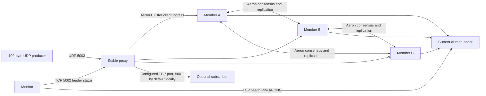

# System overview

## Purpose and boundaries

The demo has three Aeron Cluster voters, one stable proxy, a monitor, a fire-and-forget UDP producer, and an optional TCP observer. The cluster elects its own leader; the monitor does not promote members. The proxy preserves the producer and observer endpoints while its Aeron Cluster client follows the elected leader.

This is a demonstration, not a production zero-loss system. UDP producer ingress is unacknowledged and can lose packets before the proxy journals them. The proxy's durable outbox protects only messages that reached and were journaled by that proxy.

## Topology

In the diagram, only one voter is leader at a time. Aeron Cluster replicates committed service state through its consensus protocol. A three-voter cluster can keep quorum with one voter down; a single remaining voter cannot commit new work.

## Component responsibilities

| Component | Responsibility | Persistent state |
|---|---|---|
| Publisher | Generates the fixed 100-byte payload and sends datagrams to the configured proxy host/UDP port. | ID reservation file, to avoid reusing IDs after restart. |
| Proxy | Receives datagrams, tracks ingress gaps, queues and batch-journals unique payloads, and forwards outbox entries to Aeron Cluster. | Append-only outbox and `.commit` cursor. |
| Cluster members A/B/C | Replicate the committed stream sequence and deduplicate the last request ID in service state. | Separate archive and cluster directories per member. |
| Monitor | Reads current leader ID from proxy status and pings only that leader. | None. |
| Subscriber | Observes monotonically increasing stream sequence values through the stable proxy TCP endpoint. | Optional last-sequence cursor; no replay is provided. |

## Stable connectivity

Producer and observer connections target the proxy, not an individual voter. During a cluster election, the proxy reconnects/retries its pending work, and observer clients retain the same proxy endpoint. Proxy availability itself is not made redundant by Aeron Cluster and is a separate failure domain.

The default transport in this demo uses Aeron UDP unicast endpoints. Multicast is not required for election and is not configured by this example.
